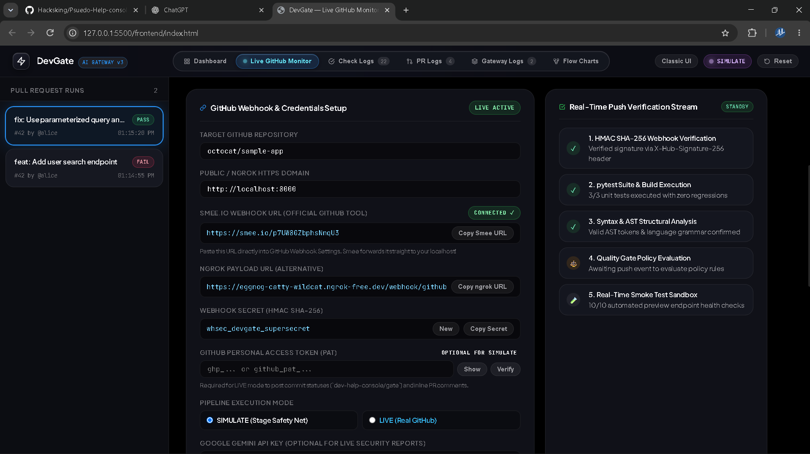
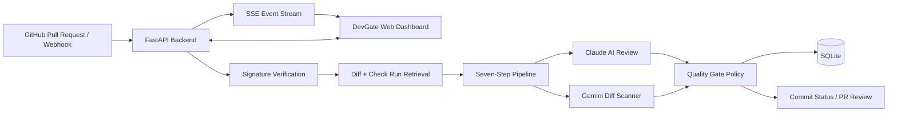
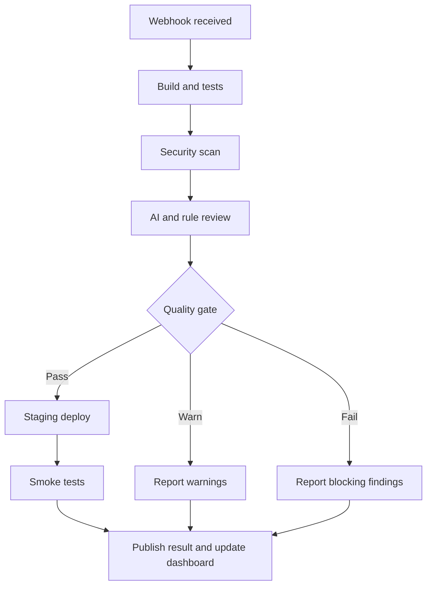

<div align="center">

# ⚡ DevGate
### AI-Powered Pull Request Quality Gate & Live GitHub Monitor

**Review code changes. Surface risks. Make safer merge decisions.**

<p>
  
  
  
  
  
</p>

<p>
  <em>A lightweight DevOps console for pull-request monitoring, automated code diagnostics, and quality-gate decisions.</em>
</p>

</div>

---

## 🖥️ Project Preview



> **Dashboard preview:** The Live GitHub Monitor brings webhook configuration, repository credentials, verification steps, and pipeline status into one dark, operations-focused interface.

## ✨ What is DevGate?

DevGate is a lightweight DevOps quality-gate console that helps teams inspect pull requests before changes move further through a delivery pipeline. It combines GitHub webhook events, CI/CD visibility, static code diagnostics, AI-assisted review, and configurable merge-gate decisions in a browser-based dashboard.

It supports two operating modes:

| Mode | What it does | Best for |
|---|---|---|
| **Simulation** | Runs fixture-based scenarios and simulated pipeline steps without requiring external credentials. | Local demos, development, and presentations |
| **Live** | Receives GitHub webhooks, fetches PR diffs, checks GitHub Actions results, runs configured AI review, and can publish statuses or review comments. | Testing a real repository integration |

**Design goal:** make code-quality signals visible, explainable, and actionable without requiring a heavy frontend build system.

## 🚀 Core Features

### 1. Pull-request quality gate
Every run moves through a seven-step pipeline:

1. Webhook received
2. Build and tests
3. Security scan
4. AI and rule review
5. Quality gate
6. Staging deploy
7. Smoke tests

The gate returns one of three outcomes:

- 🟢 **PASS** — no blocking failures or high-severity findings.
- 🟡 **WARN** — medium-severity findings exist, but no blocking issue was detected.
- 🔴 **FAIL** — a required pipeline step failed or a critical/high finding was reported.

### 2. AI-assisted pull-request review
- Uses Anthropic Claude when live AI review is enabled.
- Validates review output with Pydantic models.
- Filters findings to changed files, sorts by severity, and limits the displayed result set to eight findings.
- Supports deterministic local fixture replay when `REPLAY_AI=true` or a Claude key is unavailable.

### 3. Gemini-powered custom diff scanner
Submit a unified diff to inspect code structure and potential risks. The scanner extracts:
- Changed files and addition/deletion counts
- Language distribution
- Python and JavaScript/TypeScript functions or classes touched
- Basic Python syntax alerts
- Security patterns including SQL injection, hardcoded credentials, and unsafe `eval` / `exec` usage

When configured, Google Gemini generates diagnostic and remediation guidance alongside a gate recommendation.

### 4. Live GitHub monitoring
- Handles GitHub `ping`, `push`, and `pull_request` webhook events
- Validates webhook signatures using HMAC-SHA256
- Retrieves pull-request diffs and metadata
- Polls GitHub Actions check runs for tests and Semgrep
- Can publish commit statuses using `dev-help-console/gate`
- Can publish pull-request reviews, including inline findings when diff-line placement is possible
- Verifies GitHub tokens and repository configuration from the dashboard

### 5. Real-time dashboard
- Run history and pipeline progress
- Detailed run timelines, logs, findings, and gate outcomes
- Live webhook monitor and recent-event history
- Custom code scanner and Gemini reports
- Server-Sent Events (SSE) updates while runs are executing
- Simulation controls for vulnerable and fixed PR scenarios
- Reset and failure-explanation actions
- Dark theme with an optional classic theme

## 🧭 How It Works

### High-level architecture



> **Note:** Claude review and Gemini scanning are separate analysis paths. Which path runs depends on the workflow and configuration.

### Pull-request execution lifecycle



### Simulation workflow
1. Choose **Simulate bad PR** or **Simulate fix** in the dashboard.
2. The backend loads the matching fixture diff.
3. The shared pipeline engine executes against the fixture.
4. Review findings are loaded from JSON fixtures when replay mode is enabled.
5. Steps, findings, and gate results are stored in SQLite.
6. SSE events update the dashboard as execution progresses.

### Live workflow
1. GitHub sends an event to `POST /webhook/github`.
2. DevGate validates `X-Hub-Signature-256`.
3. Pull-request metadata and the diff are retrieved.
4. GitHub check runs are polled for configured CI/security checks.
5. Claude reviews changed code unless replay mode is enabled.
6. Gate policy evaluates failed steps and finding severity.
7. Configured GitHub commit status and PR review actions are published.
8. The dashboard receives updates through `GET /api/events`.

## 🧰 Technology Stack

| Layer | Technologies |
|---|---|
| Backend API | Python, FastAPI, Uvicorn |
| Validation & settings | Pydantic, pydantic-settings |
| Persistence | SQLite |
| HTTP / GitHub API | httpx |
| AI pull-request review | Anthropic Claude API |
| Custom diff diagnostics | Google Gemini API |
| Frontend | HTML, CSS, vanilla JavaScript |
| Live updates | Server-Sent Events (SSE) |
| Testing | pytest, pytest-asyncio |
| Webhook security | HMAC-SHA256 signature verification |

## 📁 Repository Structure

```text
psuedo-help-console/
├── backend/
│   ├── app/
│   │   ├── main.py              # FastAPI routes and webhook workflows
│   │   ├── pipeline.py          # Seven-step pipeline execution
│   │   ├── gate.py              # Quality-gate policy
│   │   ├── reviewer.py          # Claude review and fixture fallback
│   │   ├── gemini_scanner.py    # Diff metrics and Gemini reports
│   │   ├── github_client.py     # GitHub API and webhook helpers
│   │   ├── events.py            # In-memory SSE event bus
│   │   ├── db.py                # SQLite schema and query helpers
│   │   ├── simulate.py          # Demo scenarios
│   │   └── config.py            # Environment-backed settings
│   └── tests/
├── frontend/
│   └── index.html               # Single-page dashboard
├── demo/
│   └── fixtures/                # Example diffs and review JSON
├── sample-app/                  # Example repository for live testing
├── scripts/
│   └── make_demo_branches.sh
├── .env.example
├── requirements.txt
├── demo.db
└── README.md
```

## ⚙️ Getting Started

### Requirements
- Python **3.11 or newer**
- `pip`
- Git (recommended for repository workflows)

For live mode, also prepare the relevant GitHub credentials, webhook secret, public HTTPS tunnel, and AI API keys. Simulation mode can run without these external credentials.

### 1. Install dependencies

Run these commands from the project root:

```bash
pip install -r requirements.txt
```

### 2. Configure environment variables

Create your local environment file from the example:

**Windows Command Prompt**
```bat
copy .env.example .env
```

**PowerShell**
```powershell
Copy-Item .env.example .env
```

**macOS / Linux**
```bash
cp .env.example .env
```

Edit `.env` and add only the values needed for your chosen mode. Keep real secrets out of Git.

### 3. Start the server

```bash
uvicorn backend.app.main:app --reload --port 8000
```

Open **http://localhost:8000** in your browser.

### 4. Run an offline demo

Use these settings in `.env`:

```ini
DEMO_MODE=simulate
REPLAY_AI=true
```

This mode uses local fixture data and simulated pipeline behavior, so you can demonstrate the workflow without making live GitHub or AI calls.

## 🔐 Configuration Reference

| Variable | Purpose |
|---|---|
| `DEMO_MODE` | `simulate` or `live`; defaults to `simulate` |
| `REPLAY_AI` | Reuse local review fixtures instead of calling Claude |
| `PUBLIC_BASE_URL` | Public URL used for webhook and status links |
| `CLAUDE_MODEL` | Anthropic model identifier |
| `ANTHROPIC_API_KEY` | Claude API key for live PR review |
| `ANTHROPIC_BASE_URL` | Optional Claude-compatible proxy URL |
| `GITHUB_TOKEN` | GitHub API access and status/review writes |
| `GITHUB_WEBHOOK_SECRET` | Secret used to verify webhook signatures |
| `CUSTOM_REPO` | Default monitored repository in `owner/repository` format |
| `NGROK_URL` | Optional public tunnel URL for local webhook testing |
| `GEMINI_API_KEY` | Google Gemini API key for custom code reports |
| `GEMINI_MODEL` | Gemini model identifier |

**Security reminder:** never commit `.env`, GitHub tokens, webhook secrets, or AI API keys. Use placeholder values in example configuration files and rotate any credential that has been exposed.

## 🔌 API Reference

| Method | Endpoint | Purpose |
|---|---|---|
| `GET` | `/` | Serve the DevGate frontend |
| `GET` | `/api/config` | Read active mode and model configuration |
| `GET` | `/api/runs` | List recent pipeline runs |
| `GET` | `/api/runs/{run_id}` | Read one run, its steps, and findings |
| `POST` | `/api/runs/{run_id}/explain` | Explain a failed run and suggest remediation |
| `GET` | `/api/events` | Subscribe to live SSE updates |
| `POST` | `/api/simulate/bad` | Start the vulnerable demo scenario |
| `POST` | `/api/simulate/fixed` | Start the fixed demo scenario |
| `POST` | `/api/reset` | Clear stored demo runs |
| `GET` | `/api/monitor/config` | Read live monitor configuration |
| `POST` | `/api/monitor/setup` | Update and persist monitor settings |
| `POST` | `/api/github/verify-token` | Verify GitHub token and repository |
| `GET` | `/api/webhooks/history` | Read recent webhook events |
| `POST` | `/api/webhooks/clear` | Clear in-memory webhook history |
| `POST` | `/api/scan/custom-diff` | Analyze a unified diff and generate a Gemini report |
| `POST` | `/api/monitor/test-ping` | Generate a test webhook event |
| `POST` | `/webhook/github` | Receive GitHub webhook payloads |

## 🧪 Testing

Run the backend test suite from the repository root:

```bash
pytest backend/tests/ -v
```

The documented test coverage includes gate decisions, Claude response parsing and filtering, webhook signature verification, diff-line indexing, simulation behavior, and webhook routes.

## 🧯 Demo Scenarios

The included fixtures demonstrate a vulnerable and a remediated user-search change.

| Scenario | Example issue / change | Expected result |
|---|---|---|
| **Bad PR** | Raw SQL query and an exposed-credential pattern | **FAIL** |
| **Fixed PR** | Parameterized query and environment-backed credentials | **PASS** |

The fixed scenario is expected to proceed through the simulated deploy and smoke-test stages. Use the sample application and `scripts/make_demo_branches.sh` to reproduce the scenarios in a separate Git repository.

## 🛡️ Security, Reliability & Limitations

- Protect webhook requests with `GITHUB_WEBHOOK_SECRET`.
- Use a GitHub token with only the repository permissions required for the configured operations.
- Validate and filter AI output before allowing it to influence gate decisions.
- Monitor logs and fallback behavior when AI services are unavailable.
- The current event bus and webhook history are in-memory; a process restart clears active SSE subscribers and webhook history.
- SQLite is suitable for a local demo or small installation. Multi-worker production deployment would require shared persistence and a shared event broker.
- The frontend is a single large HTML file and does not require a separate JavaScript build step.
- A configured integration is not the same as a production security certification; review permissions, secret handling, failure modes, and deployment controls before using it to protect critical repositories.

## 🗺️ Roadmap Ideas

These are possible future improvements, not claims about currently implemented functionality:

- [ ] Add role-based access and audit history
- [ ] Add configurable severity thresholds and repository policies
- [ ] Add retry/backoff controls for external API failures
- [ ] Add structured application logging and metrics
- [ ] Add shared event storage for multi-worker deployments
- [ ] Add CI checks for formatting, typing, and dependency vulnerabilities
- [ ] Add deployment documentation and a production hardening checklist

## 🤝 Contributing

1. Fork the repository.
2. Create a feature branch.
3. Keep changes focused and add tests for behavior changes.
4. Run `pytest backend/tests/ -v`.
5. Open a pull request describing the problem, implementation, and validation.

For bug reports, include reproducible steps, expected behavior, actual behavior, and relevant redacted logs. **Do not include secrets or private repository data.**

## 📄 License

No license information was included in the supplied project notes. Add the license chosen for this repository and update this section before public distribution.

---

<div align="center">

**DevGate — Make every code change easier to inspect before it ships.**

<sub>Built for clearer reviews, visible quality signals, and safer development workflows.</sub>

</div>
